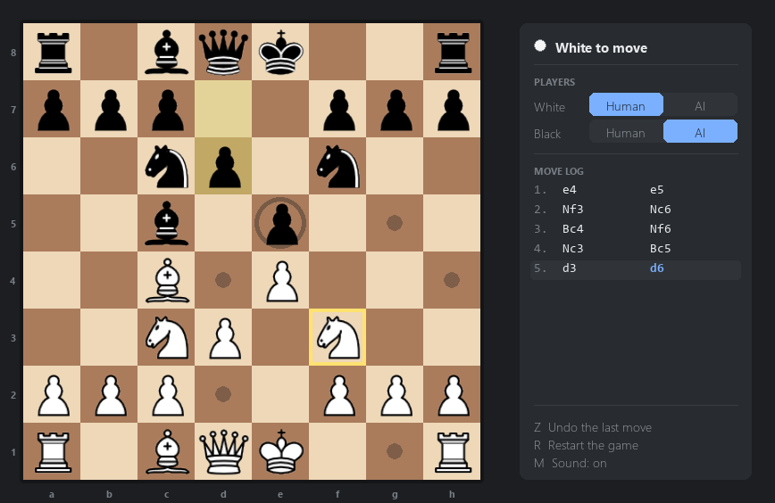

# chess-game-plus-engine

A chess game written from scratch in Python with pygame. It plays a full game of chess, rules and
all, and it comes with a built in opponent you can switch on for either colour.



## Running it

You need Python 3 and pygame 2.

```
pip install pygame
cd chess
python ChessMain.py
```

## Playing

Click a piece to pick it up, then click where you want it to go. The piece you selected gets a
yellow outline, and every square it can legally reach is marked: a **dot** for an empty square, a
**ring** around any piece it can take. Click the same piece again to put it back down.

Everything else is on the keyboard:

| Key | What it does |
| --- | --- |
| `Z` | Take back the last move |
| `R` | Start a new game |
| `M` | Turn the sound on or off |

When a pawn reaches the far side of the board, a small panel appears asking what it should become.
Click one of the four pieces, or press `Q`, `R`, `B` or `N`.

## Playing against the computer

The **PLAYERS** section at the top of the side panel controls who plays each colour:

```
White   [ Human ][  AI  ]
Black   [ Human ][  AI  ]
```

Click either half to switch. Both start on Human, so out of the box it is two people at one
keyboard. Set Black to AI and the computer takes over the black pieces on its next turn. Set both
to AI and the game plays itself.

You can change this any time, even mid game. Switching a colour back to Human stops the computer
immediately and hands the pieces back to you.

## What the side panel shows you

- **Whose turn it is**, and whether that player is in check, checkmated or stalemated. It says
  "Thinking..." while the computer is working out its move.
- **The players section** described above.
- **The move log**, written in normal chess notation (`e4`, `Nf3`, `exd5`, `O-O`, `e8=Q`). It
  scrolls on its own so the newest move is always in view, and the most recent move is highlighted.
- **The keyboard shortcuts**, as a reminder.

On the board itself, the two squares of the last move played stay tinted, and a king in check gets
a red glow behind it.

## Sounds

Moves, captures, castling, check, promotion and the end of the game each have their own sound, and
they are meant to sound like real wooden pieces on a real board. The move and capture sounds have
several variations that are picked at random, so repeated moves do not sound like the same click
on a loop.

The sound files live in `chess/sounds/`. They are generated rather than recorded — running
`python chess/sounds/generate_sounds.py` rebuilds them, and the tables at the top of that file are
where you change how they sound. If you would rather use your own, just drop `.wav` files into
that folder using the same names.

If the computer has no working audio, the game notices and runs silently instead of refusing to
start.

## How the code is laid out

| File | What it is |
| --- | --- |
| `chess/ChessMain.py` | Everything you see and click: the window, the board, the side panel, the sounds |
| `chess/ChessEngine.py` | The rules. Tracks the board, works out which moves are legal, handles undo |
| `chess/ChessAI.py` | The computer opponent |
| `chess/sounds/` | The sound effects, and the script that generates them |
| `chess/piece-images/` | The piece artwork |

The engine handles the awkward parts of chess properly: castling, en passant, promotion, pins,
check, checkmate and stalemate.

The opponent searches ahead using negamax with alpha-beta pruning — it looks at every reply to
every move it is considering, and stops exploring lines that have already turned out worse than
something it has found. How far ahead it looks is the `DEPTH` setting at the top of `ChessAI.py`.
It is kept low so the computer answers quickly; raising it makes it play better but think for
noticeably longer, since each extra step multiplies the number of positions it has to look at.

## Ideas for later

Things worth adding next are written up in [improvements.md](improvements.md).
